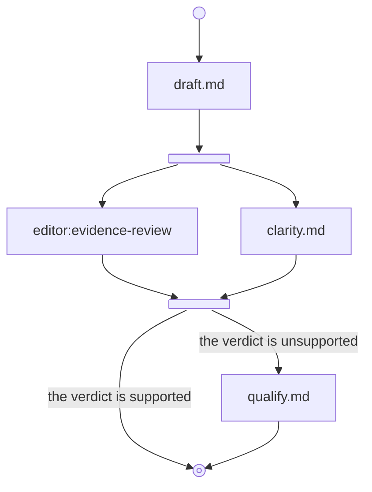
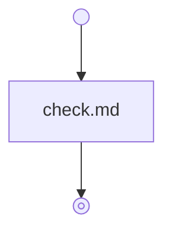

# Example: prepare a release brief

Create a workflow skill with standard frontmatter and the marker. Put this graph first in its body:

`editor:evidence-review` represents an available review skill. Supply Candidate and Evidence; receive Verdict and Reasons. Use its actual installed identifier.

Write these self-contained instructions under steps:

| File | Content |
| --- | --- |
| `_start.md` | Inputs: change facts and evidence notes. Require both, preserving uncertainty. Return Facts and Evidence. |
| `draft.md` | Given Facts and Evidence, write Candidate describing the change and its evidence limits. Return Candidate and Evidence. |
| `split.md` | Given Candidate and Evidence, dispatch review with both artifacts and clarity with Candidate. Collect Verdict, Reasons, and Clarity note. Include a Join section containing gather. |
| `clarity.md` | Given Candidate, assess readability without asserting factual truth. Return Clarity note for that candidate. |
| `gather.md` | Given Candidate and all branch outputs, wait for both reviews. Retain their original-candidate scope. Return Candidate, Verdict, Reasons, and Clarity note. |
| `qualify.md` | Given Candidate and unsupported Reasons, remove or qualify unsupported claims. Return the revised Candidate and unchanged original review, noting that the revision received no second review. |
| `_stop.md` | Outputs: final Brief, original Verdict and Reasons, and original Clarity note. Check that all exist. Label reviews as assessing the original candidate. |

Use Inputs and Outputs headings for the start and stop contracts. Other wording can remain ordinary Markdown. No branch modifies shared files in this example.

## A nested review workflow

The review skill can itself contain this marked graph:

Its start requires Candidate and Evidence as separate artifacts. Its check compares each claim with Evidence, returning supported only when every factual claim has support and preserves its limits. Its stop returns Verdict and Reasons. The parent resumes at gather after this child and the clarity branch complete.

For a trial, supply the fact that an export accepts `--output` and evidence that a check used that option successfully, with default behavior untested. The brief should preserve that limitation. A claim of improved speed without a baseline should return unsupported and follow qualify.
