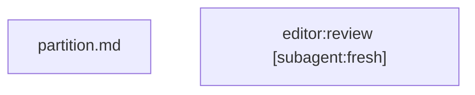
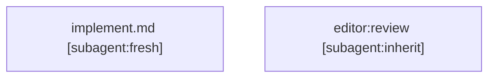

# Graph workflow standard

A graph workflow is a Markdown document with this frontmatter marker:

```yaml
metadata:
  workflow: mermaid-v1
```

Installable workflow skills also keep the standard name and description fields. Referenced Markdown workflows need only the marker. Put one Mermaid fence first in the body, followed only by optional `## Notes` bullets. Use `flowchart TD`.

## Nodes and Markdown

A node names a relative Markdown path or a plugin:skill identifier:



Skill entries named SKILL.md and supporting example entries named WORKFLOW.md read instructions from steps/. Other workflow files read instructions from a sibling directory matching their filename stem:

```text
steps/implement.md             # nested workflow graph
steps/implement/_start.md      # its start instructions
steps/implement/partition.md   # partition["partition.md"] resolves here
steps/implement/_stop.md       # its stop instructions
```

Resolve Markdown paths within the applicable instruction directory. A referenced Markdown file can contain instructions or another marked workflow. A skill reference can name a prose skill or a graph workflow.

| Node | Declaration | Instruction path within its directory |
| --- | --- | --- |
| Start | `_start@{ shape: sm-circ, label: "Start" }` | `_start.md` |
| Stop | `_stop@{ shape: framed-circle, label: "Stop" }` | `_stop.md` |
| Markdown instructions | `draft["draft.md"]` | `draft.md` |
| Skill reference | `review["editor:review"]` | The referenced skill |
| Fork | `split@{ shape: fork, label: "fork" }` | `split.md` |
| Join | `gather@{ shape: fork, label: "join" }` | `gather.md` |

Declare each node once. Identifiers contain letters, digits, and underscores and start with a letter or underscore.

Each node instruction file must explain its purpose, required inputs, actions, and returned outputs without another node's prose or hidden history. Pass previous results as explicit artifacts. Headings are optional except where this standard locates a contract or pairing.

Start's Inputs bullets define the workflow inputs. Stop's Outputs bullets define its returned results. Stop can name a Markdown template under Output template, relative to its own file. Templates are text, never executable code. Nodes choose their own work locations; this standard prescribes no output or scratch directories.

## Edges

Use `a --> b` for unconditional flow and `a -->|condition| b` for a decision. Never mix unconditional and conditional edges from one source. Edges out of a fork and into a join must be unconditional.

A decision takes exactly one true condition after assessing every outgoing condition. Unknown evidence, multiple true conditions, or no true condition blocks execution. Edge order gives no priority. Conditions require agent judgment; validation cannot prove their truth or completeness.

Use one declaration or edge per line. The CLI accepts this subset, blank lines, and Mermaid comments. It does not execute Mermaid, HTML, directives, or handlers. Every node must be reachable from start and have a route to stop. Start has no incoming edges; stop has no outgoing edges. Cycles and recursive references have no imposed execution cap.

## Threads and nested workflows

Append `[subagent:fresh]` or `[subagent:inherit]` inside a node's quoted label:



The annotation is not part of the Markdown path or skill identifier. No annotation means continue on the same thread. Fresh requests only declared inputs and necessary instructions; inherit requests available context. Comments do not set execution preferences.

These are preferences. Use the closest supported behavior when the harness lacks subagents, context control, or parallelism. Still execute the work, without routine capability disclaimers or false capability claims.

When next returns a Markdown path, read it; when it returns a skill identifier, resolve the skill. If the target has the workflow marker, read its graph, Notes, and stop contract, then call `start CHILD_FILE` to obtain its start instructions. Supply its inputs explicitly, run through stop, then return its declared results to the parent before advancing from the referencing node. Follow other Markdown instructions or a prose skill's own instructions directly. Resolve missing or ambiguous inputs before acting. Missing references block execution; the CLI can only check locally available references.

## Fork and join

Fork dispatches every outgoing branch. A fork's Markdown instructions include a Join section naming its matching join:

```markdown
## Join

gather
```

This pairing identifies where nested branches return. Branch inputs and returned outputs stay free-form. Join's Markdown instructions describe how to combine those outputs; its graph label already identifies the role, so no duplicate role field is needed.

Run branches concurrently when supported, following their thread annotations. Otherwise execute them using the closest supported arrangement. Keep each branch's artifacts explicit and coordinate shared effects. Wait for every branch before executing the join once. Propagate failures unless its instructions define authorized recovery. Never substitute missing results with success.

A node's Markdown instructions can explicitly dispatch N work packages when the count depends on task inputs. Return the package handles or results as declared outputs and collect every outcome before returning an integrated result. This is work prescribed within the node; graph edges retain their declared meaning.

Branches must stay separate until their matching join. Nested forks and multiple nodes per branch are allowed. A graph route to stop does not prove runtime termination. Continue only while the conditions and authorized task justify the work.

## CLI

Run `python3 /path/to/graph-workflows/scripts/workflow.py` with one of:

- `validate FILE`: check local graph and references, including nested Markdown workflows; success produces no stdout.
- `start FILE`: begin a workflow by returning its start instruction path. Read and execute it before advancing.
- `next FILE NODE`: after executing NODE, return the next path or identifier. For example, `next FILE start` advances past start. Supply `--true TARGET` or `--false TARGET` for each conditional target. Resolve uncertainty before calling next.
- `fork FILE NODE`: return every branch target, one per line. No condition flags apply.

Unannotated targets produce only an instruction path or skill identifier. Annotated targets produce one instruction per line:

- `Spawn a subagent with fresh context: TARGET`
- `Spawn a subagent inheriting the context from this thread: TARGET`

TARGET is the resolved instruction path or skill identifier. These instructions express the node's preference. The CLI accepts start and stop as aliases for _start and _stop when no exact node matches. There is no JSON envelope or status chatter. An edge to stop returns the stop instruction path; execute those instructions and return their Outputs. Calling next on stop produces no stdout and exits successfully: this workflow is complete. A nested workflow returns to its caller; a top-level workflow returns to the user. Errors go to stderr with a nonzero exit status. The CLI does not execute instructions, judge conditions, or create agents.

Use `--root DIR` to check local plugin or skill collections. Instruction and template paths must remain inside the workflow's containing directory; physical link targets must remain inside the supplied root. Unavailable plugin namespaces remain skill identifiers for the harness to resolve.

Expanded shapes come from [Mermaid 11.3.0 and later](https://mermaid.js.org/syntax/flowchart.html#expanded-node-shapes-in-mermaid-flowcharts-v1130). The reference, pairing, and execution conventions above belong to this skill.
